# JamRoom 🎵

JamRoom is a real-time collaborative music player and broadcasting platform. It allows users to create rooms, join together, and listen to synchronized audio. Whether you are playing local files, extracting streams from YouTube or SoundCloud, or broadcasting live system audio over WebRTC—JamRoom keeps everyone in the room perfectly in sync.

## ✨ Features
- **Real-Time Synchronization**: Audio playback stays in sync across all clients in a room.
- **WebRTC Live Audio**: Broadcast your live system/mic audio to all participants with low latency.
- **Local File Uploads**: Upload and share local audio files securely.
- **Mobile-First Responsive UI**: Beautifully designed Next.js interface with album art presentation and built-in chat.
- **Robust State Management**: Built on top of Next.js and FastAPI to eliminate race conditions and keep room state unified.

---

## 📸 Application Screenshots

#### 1. Landing Page & Room Entry
*Welcome screen to jump straight into music jams or host your own session.*
The main landing page features JamRoom's vibrant interface, allowing participants to enter a 6-character room code to join an active session or quickly host and start a new listening jam.

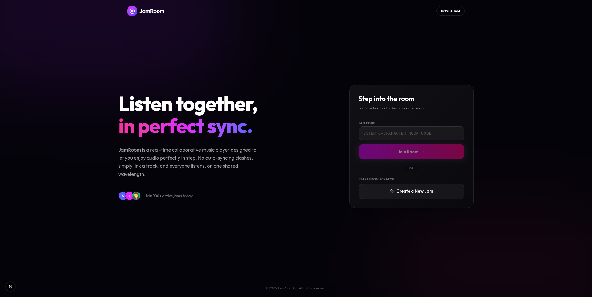

#### 2. Create a Listening Jam
*Set up a personalized room and configure your session details.*
Hosts can easily set up a new jam session by specifying a custom room name and choosing their host display name before launching the synchronized room.

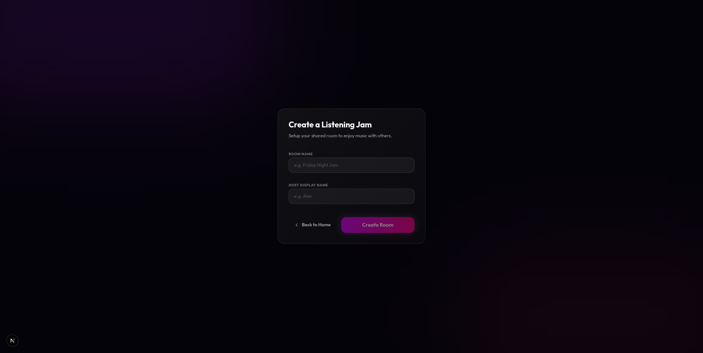

#### 3. Join a Live Jam Room
*Quick and seamless room entry for guests and participants.*
Guests can join an ongoing jam by entering the 6-character room code and picking a guest display name to immediately jump into the synchronized listening experience.

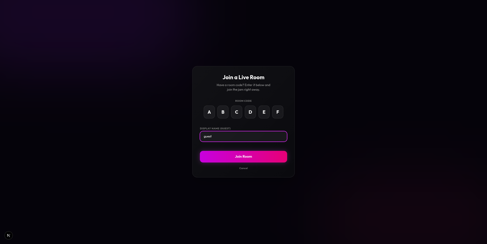

#### 4. Live Room & Synchronized Player
*The central listening hub featuring synchronized playback and track details.*
The main jam room interface displays currently playing album artwork, live sync status, playback progress, track controls, and an interactive queue of upcoming tracks.

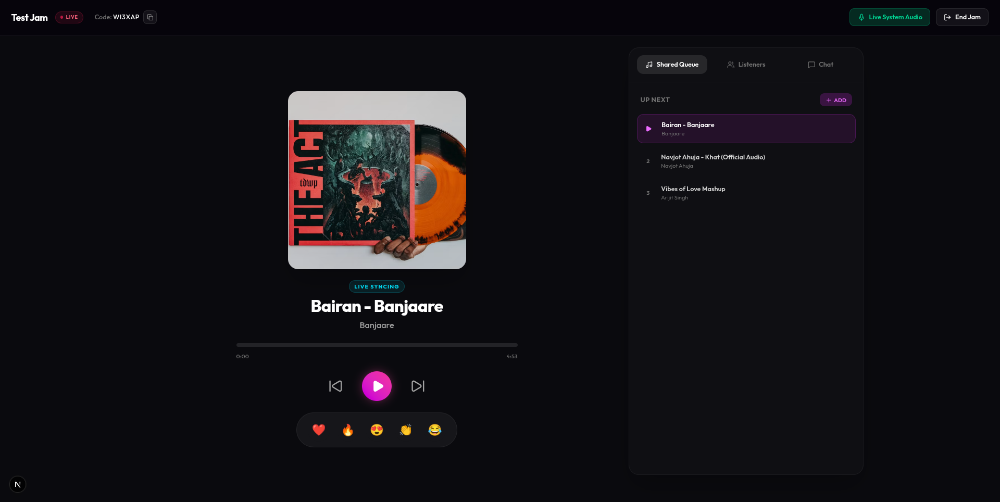

#### 5. Live Emoji Reactions
*Express the vibe in real time with animated floating emoji reactions.*
Participants can share live feedback and vibe with the room by tapping emoji reactions (hearts, fire, applause, etc.), triggering smooth floating animations visible across all listeners.

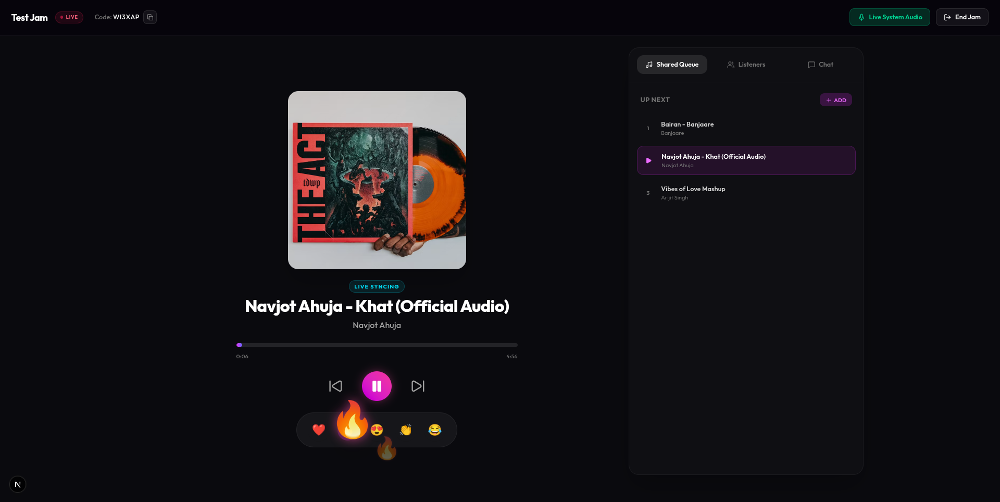

#### 6. Add Track via Web URL
*Stream music directly from online web links and media URLs.*
Users can expand the room's playlist by adding direct audio URLs or supported streaming links into the shared queue, instantly resolving media for everyone.

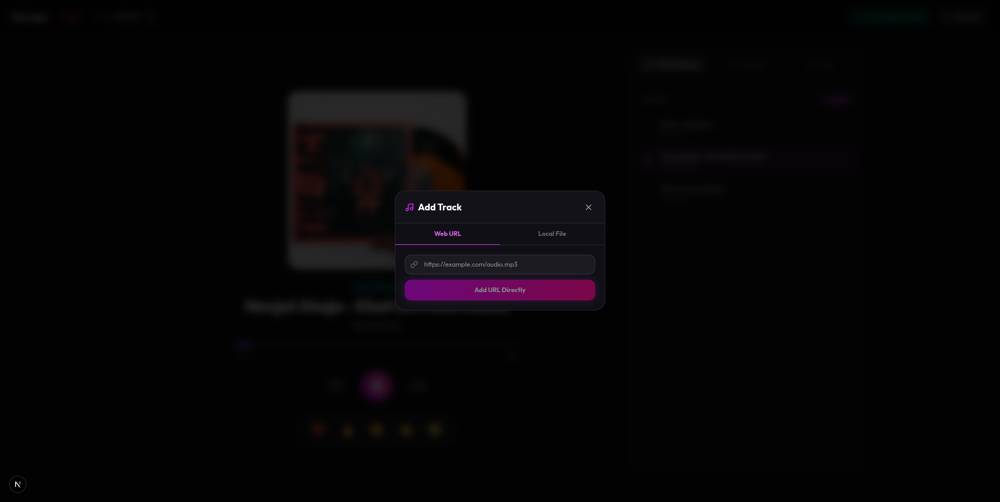

#### 7. Add Track via Local File Upload
*Upload and share local audio files straight from your device.*
Listeners and hosts can upload their own local audio files (MP3, WAV, FLAC, AAC) directly into the room with drag-and-drop support to share unreleased tracks or personal collections.

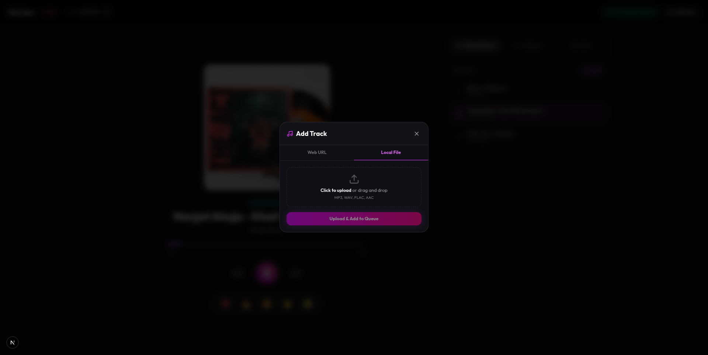

#### 8. Collaborative Shared Queue
*Real-time shared playlist management for all participants.*
The shared queue displays all upcoming tracks queued by room members, highlighting the active track, uploaded media tags, and providing controls to add more songs dynamically.

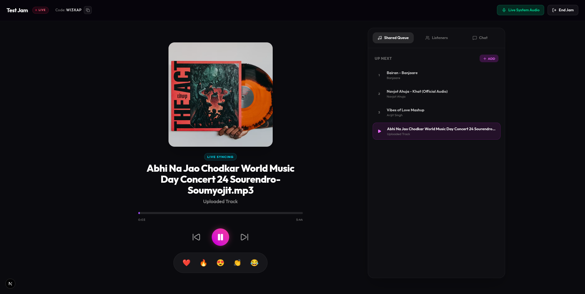

#### 9. Listeners & Participant Management
*View active listeners and manage host privileges in real time.*
The Listeners panel displays who is currently in the room, distinguishing between hosts and listeners, with host controls to delegate room ownership to other participants.

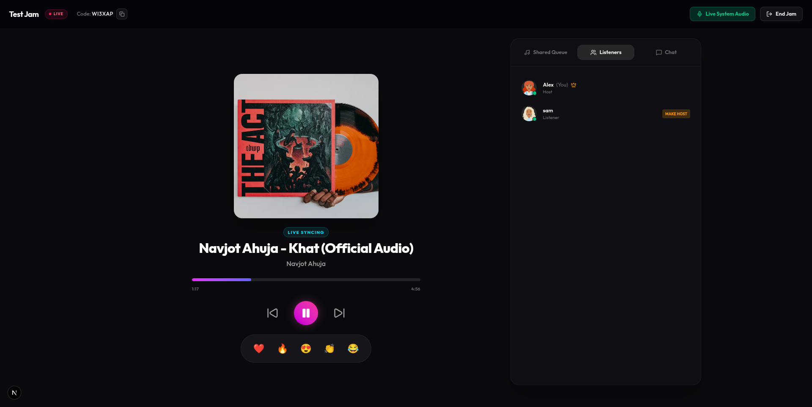

#### 10. Real-Time Chat Notifications
*Instant floating message toasts and unread badges.*
When room members send messages while viewing the queue or listeners tab, instant toast notifications pop up in the corner along with unread badges so no conversation is missed.

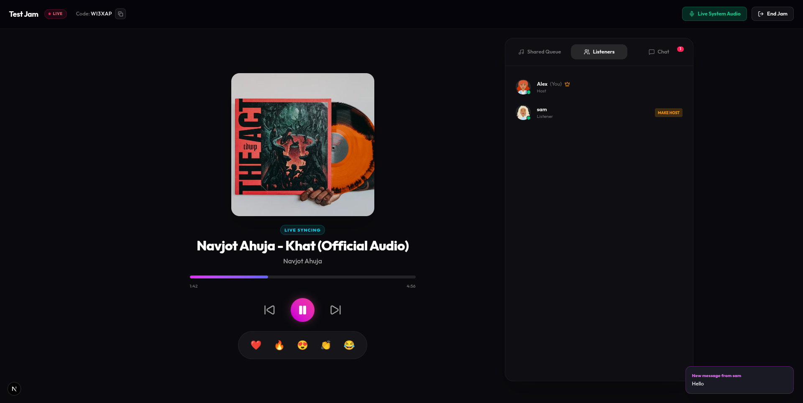

#### 11. In-Room Real-Time Chat
*Converse and connect with everyone in the room while listening.*
A built-in real-time chat tab enables lively conversations between participants alongside the music, with instant messaging and message bubbles for an engaging communal experience.


#### 12. Live System Audio Broadcasting
*Ultra-low latency live system audio sharing powered by WebRTC.*
Hosts can broadcast browser audio live to all participants in real time with WebRTC signaling, complete with active broadcasting indicators and host stream controls.

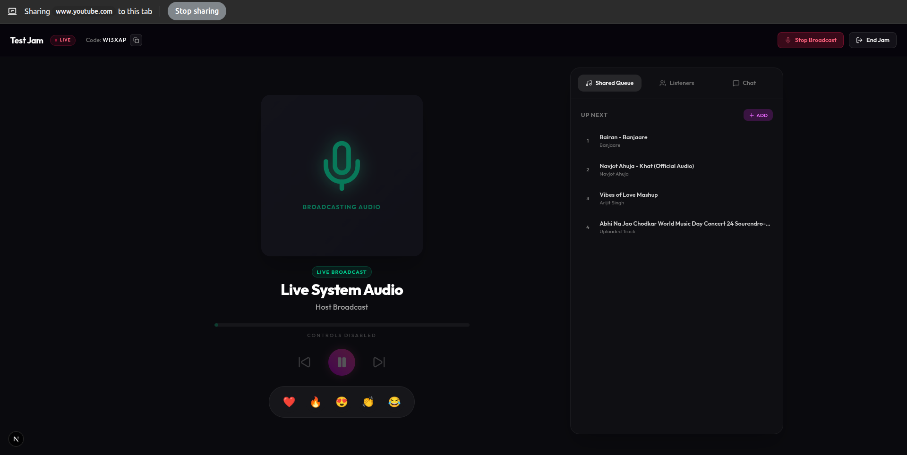

---

## 🛠️ Tech Stack
- **Frontend**: Next.js, React, Tailwind CSS
- **Backend**: Python, FastAPI, WebSockets (`python-multipart`, `pydantic-settings`)
- **Package Management**: `npm` (Frontend), `uv` (Backend)
- **Media**: WebRTC, HTML5 Audio, `yt-dlp`

---

## 🚀 Getting Started

Follow the instructions below to set up and run the frontend and backend servers locally.

### 1. Backend Setup (FastAPI)

The backend handles the WebSockets, room state coordination, API endpoints, and media resolution using Python. It uses `uv` for extremely fast dependency management.

```bash
# Navigate to the backend directory
cd backend

# Ensure you have 'uv' installed globally
# (If not, run: curl -LsSf https://astral.sh/uv/install.sh | sh)

# Install dependencies and sync the environment
uv sync

# Run the development server
uv run uvicorn main:app --reload
# OR if using FastAPI CLI
uv run fastapi dev
```

*The backend will typically run on `http://localhost:8000`.*

### 2. Frontend Setup (Next.js)

The frontend is a Next.js application tailored for mobile and desktop browsers alike.

```bash
# Navigate to the frontend directory
cd frontend

# Install dependencies using npm (or yarn/pnpm)
npm install

# Start the Next.js development server
npm run dev
```

*The frontend will typically run on `http://localhost:3000`.*

---

## 🏗️ Architecture Notes
- **WebRTC Handshake**: Handled via WebSockets on the backend to coordinate SDP offers/answers between hosts and listeners. 
- **Audio Routing**: The frontend safely negotiates browser autoplay policies while maintaining continuous connections to avoid drop-offs.
- **Duplicate Prevention**: The UI implements guards to avoid double-joining rooms or firing simultaneous media creation events.